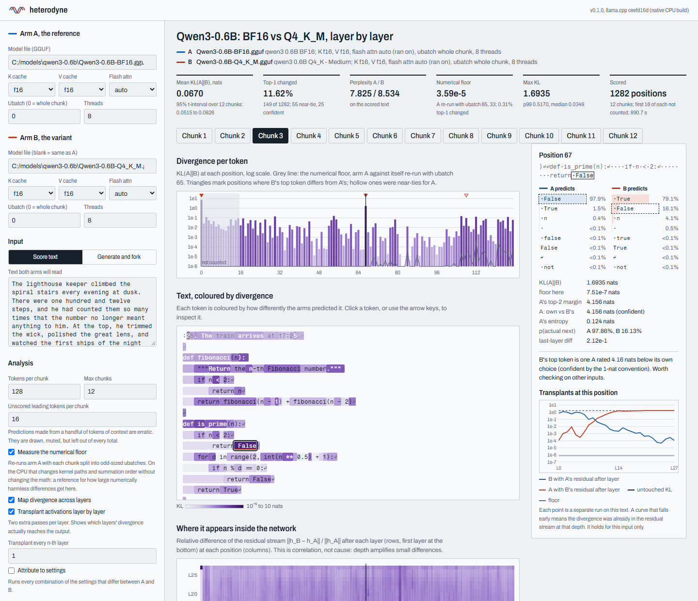

# heterodyne

**Diff two llama.cpp runs token by token and layer by layer, then move activations between
them to test which layers' divergence actually reaches the output.**

A quantized GGUF, a quantized KV cache, a different batch size, a fine-tune: each changes
what your model says, and the usual answer to "how much, and where?" is one aggregate
number. heterodyne runs two configurations of llama.cpp (two *arms*: a GGUF file plus the
runtime settings that can change its numbers) on identical tokens and shows:

- **where the outputs differ**: exact full-vocabulary KL(A‖B) and top-1 changes at every
  position, next to a measured numerical floor;
- **where inside the network the difference appears**: the residual stream of both arms
  after every layer;
- **which layers carry it to the output**: activation transplants that write one arm's
  residual stream into the other, layer by layer, in llama.cpp's own numerics;
- **which setting causes it**: every combination of the settings that differ, run and scored;
- **where a greedy answer forks**, and whether that fork survives re-scoring.

Everything runs locally on the CPU, in the same quantized kernels you actually run.
No API keys, no uploads, no Python.

